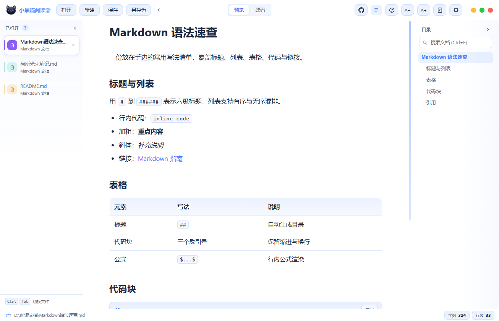

# 小黑喵阅读器 · XiaoHeiMiao Reader

一款轻量的 Windows Markdown 阅读器：多标签、右侧目录、LaTeX 公式、预览与源码双模式，单文件应用约 3 MB。

- 官网：https://alice-p197.github.io/xiaohimiao-reader/
- 发布页：https://github.com/Alice-P197/xiaohimiao-reader/releases
- 更新清单：https://alice-p197.github.io/xiaohimiao-reader/update.json



## 功能

- 多标签阅读：同时打开多份文档，切换不打断思路，未保存状态有单独标记。
- 目录导航：标题自动汇总在右侧，点击即可定位；面板可收起。
- Markdown 渲染：标题、列表、表格、引用、任务清单、图片与内链。
- LaTeX 公式：行内与行间公式均可排版，公式字体本地加载，离线可用。
- 双模式：预览看结果，源码改细节；源码模式带行号、语法高亮与格式工具栏。
- 阅读设置：浅色 / 深色主题、字号、A4 / Letter / 窄栏 / 宽屏版心。
- 本地轻量：单文件应用，文档只在本机打开，不上传云端。

支持格式：`.md`、`.markdown`、`.mdown`、`.mkd`、`.txt`。

## 安装

1. 打开[发布页](https://github.com/Alice-P197/xiaohimiao-reader/releases/latest)，下载 `XiaoHeiMiao-Reader-v1.0.0.exe`。
2. 双击运行，拖入 Markdown 文件或通过“打开”选择文件。

系统要求：Windows 10 / 11（64 位）。

## 更新

下载新版本并覆盖旧的 exe 文件即可，阅读设置与窗口布局会保留。版本信息同时写入 [`update.json`](update.json)。

## 仓库内容

```
index.html    官网首页
assets/       界面截图与图标
update.json   版本与下载清单
```

安装包通过 Releases 分发，本仓库不包含应用源码。

## 常见问题

**会修改我的文档吗？** 预览是只读的；只有在源码模式主动保存或另存为时才会写入。

**公式需要联网吗？** 不需要，公式字体随应用本地加载。

GitHub：https://github.com/Alice-P197
